# Camera Frames for Blender

[日本語](README.md)

Expand what your camera sees in any direction while keeping the composition in place. Choose an anchor and adjust the output size to add space above, below, or around your shot.

For animation production, you can place shooting FRAMEs in the camera view and export them as guides in a layered PSD. Use the eye-level guide to help compose a shot, and check each FRAME's full-frame equivalent focal length while adjusting the camera's field of view.

[Installation](#installation) · [Getting started](#getting-started) · [Updating in Blender](#update-extension)

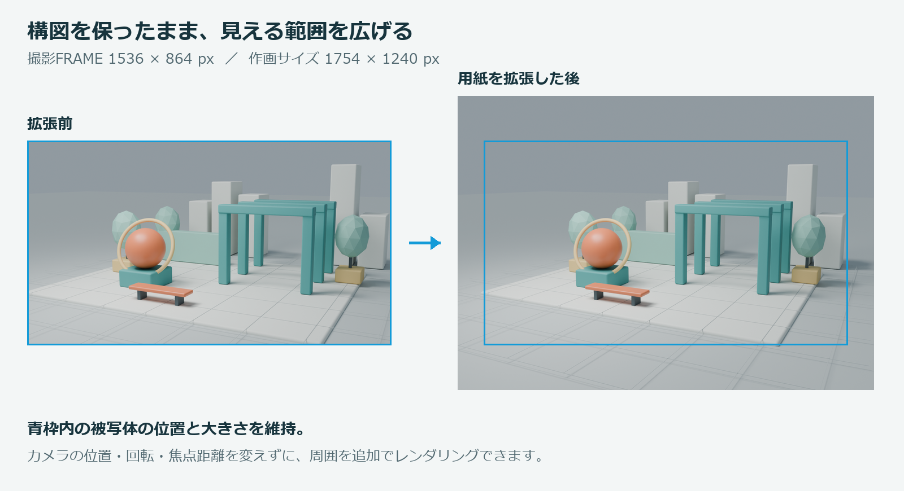

The examples use **1754 × 1240 px paper (A4 landscape at approximately 150 dpi)** and a **1536 × 864 px FRAME (16:9)**. Screenshots show the Japanese interface; the instructions below use the English UI labels.

<a id="getting-started"></a>

## Getting started

1. Select a camera object and click **Add Selected**. To create a camera, use **New Camera** beside it.
2. Enter camera view, open **Output (Paper)**, choose an anchor, and adjust the paper width and height.
3. Add FRAMEs under **FRAMEs**, then adjust their position, size, and rotation.
4. For a pan or other camera movement, add more FRAMEs and arrange them in the order the motion should follow.
5. Click **Export Guide PSD**. When combining the guides with a Blender render, use the same camera and output dimensions.

Each camera's paper settings, FRAMEs, and motion paths are saved in the `.blend` file.

The interface follows Blender's language settings. Choose English or Japanese in **Preferences → Interface**. Turning off **Interface** translation shows the English UI; tooltip translation can be switched separately.

## Create a camera with paper and a FRAME

Click **New Camera**, enter a camera name, choose a preset, and confirm with **OK**. The new camera starts with FRAME A in place. You can also enter the paper and FRAME dimensions directly.

After creation, edit the selected camera's name in the list at the top of the panel. This is the same object name shown in the Outliner, so a change in either place appears in both.

| Preset | Paper size | FRAME inner dimensions |
| --- | --- | --- |
| A4 Landscape / 150 dpi | 1754 × 1240 px | 1536 × 864 px |
| A4 Landscape / 200 dpi | 2338 × 1654 px | 2048 × 1152 px |

The FRAME starts at the paper center. Under **Offset (px)**, positive **Y** moves it down and positive **X** moves it right. For example, a downward offset can leave room for animation peg holes at the top of the sheet. The camera is created in the collection shown beside **Collection**, and the viewport switches to camera view.

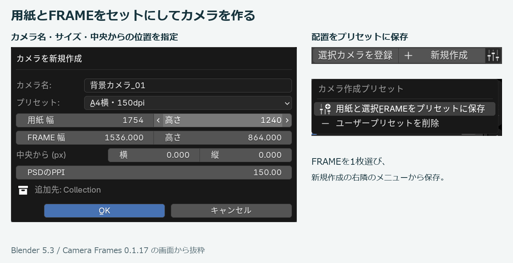

To reuse a layout, select one FRAME and open the **preset menu beside New Camera → Save Paper and FRAME Preset**. This saves the paper dimensions, the FRAME's inner size and offset from the paper center, and the PSD's PPI. Presets remain available after restarting Blender or updating Camera Frames. Use the same menu to remove a user preset.

## Expand the view while keeping the composition

In **Output (Paper)**, the **Anchor** determines which part of the composition stays fixed as you resize the paper. For example, anchor the bottom edge and increase the height to add space above the shot. You can choose the center, an edge, or a corner: nine positions in total.

Use **Set Size** to enter dimensions, or **Drag Size** to adjust them in the viewport. Drag right to increase the width and up to increase the height. **Lock Paper Aspect** preserves the paper's aspect ratio, and Shift gives finer control while dragging.

As the paper expands, the shooting FRAME keeps its position and size relative to the subject. You can compose a shot within the FRAME, then add the surrounding area needed for a pan or for drawing.

To fit the paper on screen, choose **View → Fit Paper in View**. Adjust **View Zoom %** or use the − / + buttons for a closer or wider view. **Lock Camera to View** is available in the same section.

## Place and edit FRAMEs

Click **Edit in View** to work directly in the viewport. Drag inside a FRAME to move it, or drag a corner to scale it. The **Move**, **Scale**, **Rotate**, and **Pivot** buttons start a single drag operation. Click **Finish Editing in View** when you have finished using the editing tool.

- **Select one FRAME:** Click its row in the list. The checkbox on the left shows which FRAMEs will be edited.
- **Enter exact values:** Set X, Y, Width, Height, and Rotate. X and Y locate the FRAME's center from the paper's top-left corner; Y increases downward. Width and height stay linked. **Shared Aspect** applies to all FRAMEs in that camera and defaults to 16:9.
- **Edit several FRAMEs together:** Use the list checkboxes or Shift-click in the viewport. Numeric edits and drags preserve their relative arrangement. The blue active row supplies the displayed values and the pivot for scaling and rotation.
- **Move horizontally or vertically:** Hold Shift while dragging to constrain movement to the direction you started in. Press X or Y to choose an axis, and press the same key again to release it. Ctrl gives finer movement.
- **Nudge by a pixel:** While **Edit in View** is active, use the arrow keys to move by 1 paper pixel, or Shift-arrow to move by 10 pixels.
- **Place a pivot outside the FRAME:** Both the pivot and the FRAME can move beyond the paper bounds.

For crisp horizontal and vertical outlines, use **Align to Pixels** below the FRAME list. It aligns the FRAME to pixel boundaries at the current output scale when this can be done while preserving its inner dimensions, rotation, and the relative positions of selected FRAMEs. At 100% output resolution, align the four edges and use an integer line width for crisp exported outlines. Diagonal and fractional-position outlines use antialiasing.

New FRAMEs cycle through red, blue, green, yellow, purple, and cyan. You can change each color. Names appear for the FRAMEs being edited; the **Name** checkbox in the FRAMEs header controls their visibility.

The eye icon controls viewport visibility. The **PSD** checkbox selects FRAMEs for export. Hiding a FRAME also removes it from the editing selection. Use **Select All** and **Deselect All** below the list to change the selection together.

FRAME dimensions describe the clear inner area, excluding the outline. A FRAME set to 1536 × 864 px has its outline drawn outside that area, keeping the line out of the shot when used as a compositing guide. Any part outside the paper is clipped in the PSD.

## Draw motion paths

Paths follow the order of FRAMEs in the list. Under **Motion Path**, choose **Straight** or **Bezier** in **Type**. For a curved path, drag the yellow tangent handles. You can start with **Auto** handles, switch to **Free**, and refine the curve. Select one FRAME to edit its handles numerically.

Handles attach to the FRAME centers. With two FRAMEs, the first has an outgoing handle and the last has an incoming handle. Selecting both displays the handles at both ends; dragging a handle selects its FRAME.

Use **Points** to draw the center path, all four corner paths, or a particular corner. For example, **Top Left** tracks that corner in both the viewport and PSD, including changes in FRAME rotation and scale.

## Mask the area outside the shot

Enable **Show Mask** under **Outside Mask** to darken the area outside the shooting range. Opacity can be set from 0 to 100%.

Set **Source** to **Selected FRAME** to use the selected FRAME in the blue active row. Choose **All FRAMEs' Sweep** to keep the full area covered during movement between FRAMEs. This includes S-shaped curves, rotation, and scaling.

### Vertical pan example

Here the paper has been expanded upward to **1754 × 2480 px**, with FRAME A at the bottom and FRAME B at the top. Both FRAMEs are 1536 × 864 px. The tall image provides room for a pan from the plaza up to the building.

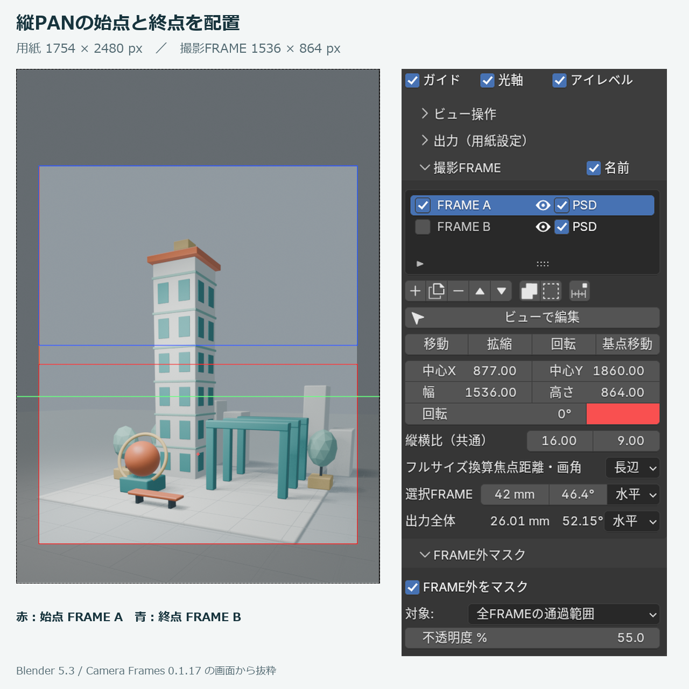

The mask uses **All FRAMEs' Sweep** at 55% opacity, and the path tracks the top-left corner. This helps you judge how much paper is needed throughout the movement.

## Check eye level, focal length, and field of view

Use **Lens Axis** and **Eye Level** near the top of the panel to show these guides. They follow camera tilt, roll, and lens shift, and can also be exported to the PSD as drawing guides. The gear button at the top adjusts the line width for all guides.

Select one FRAME and **drag either the mm or ° value to change the camera view immediately**. You can explore a composition with a 50 mm equivalent lens, or enter a horizontal field of view to match another DCC application.

| Row | What it does |
| --- | --- |
| **FRAME** | Shows the selected FRAME's equivalent focal length and field of view, and lets you adjust the camera through either value. |
| **Output** | Shows the equivalent focal length and field of view of the entire render area. |

Each row reads from left to right: target, focal length in mm, then field of view in degrees. Focal lengths are full-frame equivalents. The menu on the right chooses **Horizontal**, **Vertical**, or **Diagonal** field of view, shown on the button as **Horiz.**, **Vert.**, or **Diag.**

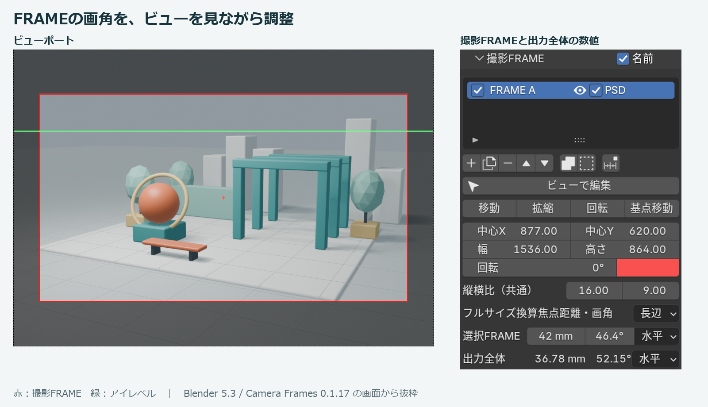

<details>
<summary>Matching live-action footage or another DCC application</summary>

The displayed field of view is measured as if the target area were centered on the optical axis. When matching a shifted lens or a FRAME away from the center, open **Long Edge** or **Diagonal** beside **35mm Equivalent / FOV** to check the optical-axis position too. The top-left corner is 0% and the bottom-right is 100%, measured separately for the FRAME and output.

Check the source image's sensor area, crop, and pixel aspect ratio as well. Match camera position, orientation, and lens distortion to the material you are working with.

</details>

## Export guides as a layered PSD

Click **Export Guide PSD** to save a PSD with a transparent background. Each FRAME has its own layer, with separate layers for the motion paths, optical axis, and eye level. FRAME names become layer names, so you can name them to suit your shot instructions.

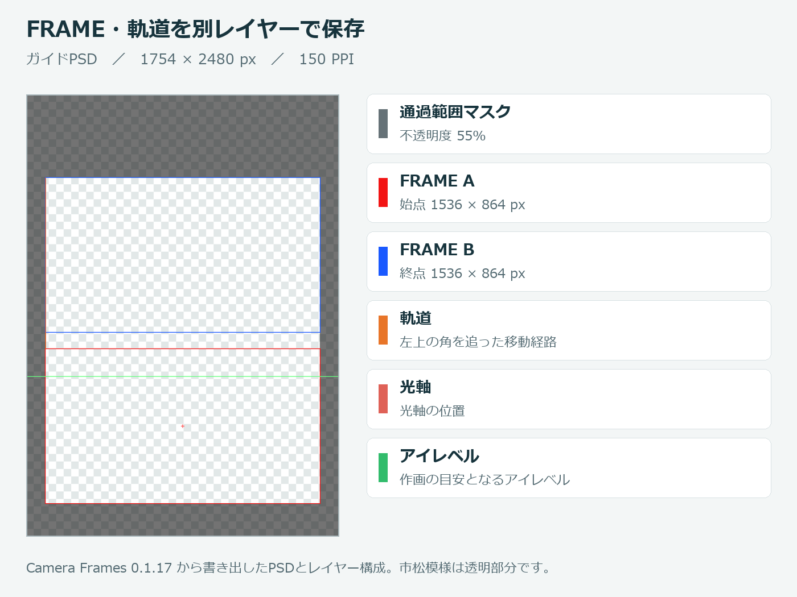

Choose FRAMEs using their **PSD** checkboxes in the list. Use the checkboxes under **Guide PSD** for the motion paths, optical axis, eye level, and mask. The optical axis and eye level are exported when they lie within the paper. **Mask to PSD** adds a bottom layer whose opacity you can adjust in an image editor.

The PSD canvas matches Blender's output size, including the resolution percentage in Output Properties. Render the scene in Blender as usual and combine the image with the PSD guides. Set the print resolution stored in the PSD with **PSD PPI**, which defaults to 150.

## Switch or duplicate cameras

Each camera can keep its own paper settings, FRAMEs, and paths. Selection is synchronized between the Camera Frames list and the Outliner. Switching cameras recalls that camera's settings, and names are shared with the Outliner.

Use **Duplicate Camera with Settings** to create another camera with the same FRAMEs and guides. This is useful for trying different compositions. Cameras duplicated with Blender's standard tools can also be added with **Add Selected**.

<details>
<summary>Supported features and limits</summary>

- **Cameras:** Local perspective and orthographic cameras are supported. Focal-length and field-of-view editing, and the eye-level guide, are for perspective cameras. Orthographic cameras show the FRAME's projected width.
- **Paper and FRAMEs:** Paper dimensions can range from 4 to 30000 px per side, with up to 128 FRAMEs per camera. FRAMEs in the same camera share an aspect ratio.
- **PSD:** 8-bit RGB, up to 30000 px per side and 64 million pixels total. Use square pixels and disable **Crop to Render Region** when combining guides with a render.
- **Viewport:** Guides follow Blender's overlay visibility. Drag editing uses a single camera view.
- **Paths and masks:** Paths and **All FRAMEs' Sweep** use every FRAME in list order, independently of viewport and PSD checkboxes.
- **Output dimensions:** If you change them in Blender, **Apply Paper Size to Output** restores the registered camera's paper settings to the output.
- **Animation:** Camera movement and rotation can be animated. If shared camera data, lens animation, or drivers prevent an edit, the panel shows the reason.
- **Other camera setups:** Panoramic and fisheye cameras, linked cameras, library overrides, and cameras shared by multiple scenes are outside the supported scope. Automatic switching through camera markers or a viewport's separate local camera is also outside this scope.

</details>

<a id="installation"></a>

## Installation

Requires **Blender 5.2 or later**. These steps follow Blender 5.3 on Windows. Editing guides and exporting PSDs work offline after installation.

| Method | How to update |
| --- | --- |
| [Install through Blender (recommended)](#install-repository) | Click Update in Blender |
| [Download and install a ZIP](#install-zip) | Download and install the newer ZIP |

If you already installed a ZIP, see [Switch from a ZIP installation to updates in Blender](#switch-from-zip).

Start by opening **Edit → Preferences…** in Blender.

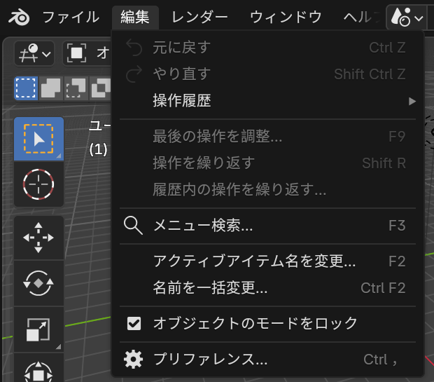

<a id="install-repository"></a>

### Install through Blender (recommended)

**1. Open Get Extensions**

Select **Get Extensions** on the left of Preferences, then click **Allow Online Access** in the initial prompt.

If you previously chose to stay offline, enable **System → Network → Allow Online Access**, then return to Get Extensions.

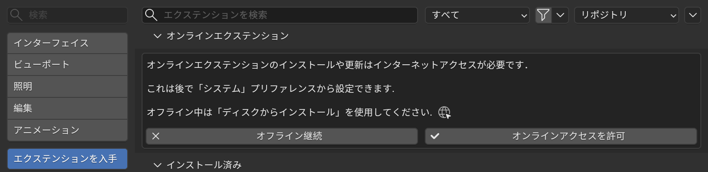

**2. Add the update repository**

At the top right, choose **Repositories → + → Add Remote Repository**.

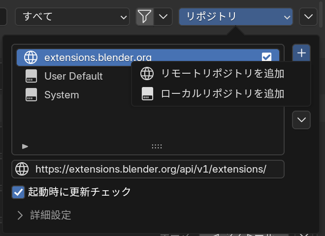

**3. Paste the URL and create the repository**

Paste this address into **URL**, enable **Check for Updates on Startup**, and click **Create**.

```text
https://stechdrive.github.io/blender-cameraframes/index.json
```

Leave the other settings at their defaults. The repository will be named **stechdrive.github.io**.

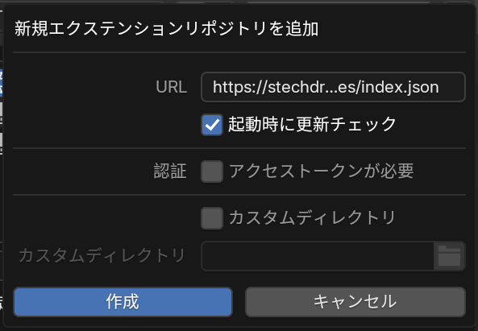

**4. Install Camera Frames**

Close the repository popover and search for **Camera Frames**. Click **Install** on its row under **Available**.

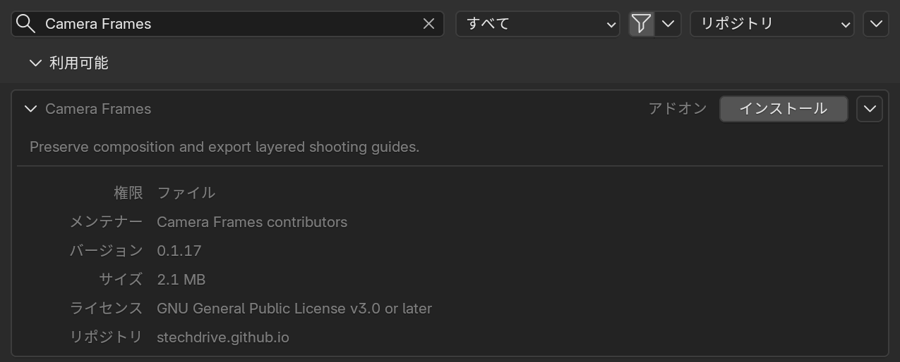

Continue to [Check the installation](#check-installation).

<a id="install-zip"></a>

### Download and install a ZIP

**1. Download the package**

Open the [latest release](https://github.com/stechdrive/blender-cameraframes/releases/latest) and download **`camera_frames-<version>.zip`** from **Assets** at the bottom of the page.

**2. Choose Install from Disk…**

In Blender, open **Edit → Preferences… → Get Extensions**, then choose **▼ → Install from Disk…** at the top right.

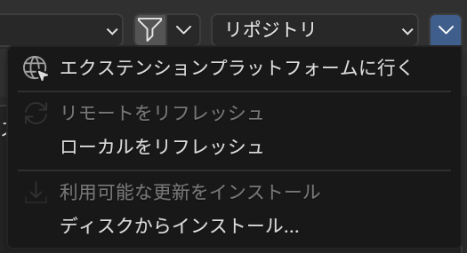

**3. Select the downloaded ZIP**

Select the ZIP **without extracting it**, enable **Enable on Install**, and click **Install from Disk…** at the bottom right.

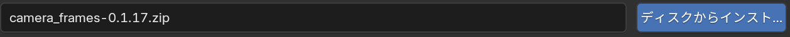

Use the same steps with a newer ZIP when updating a ZIP installation.

<a id="check-installation"></a>

### Check the installation

Select **Add-ons** on the left of Preferences, search for **Camera Frames**, and enable the checkbox beside its name.

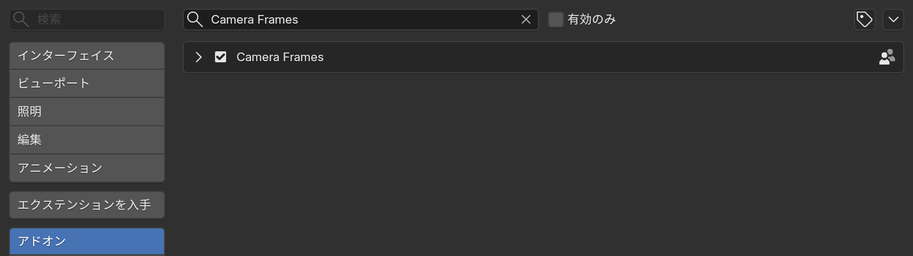

Close Preferences, place the pointer over the **3D Viewport**, and press **N**. Open the **Camera Frames** tab in the sidebar. If automatic preference saving is disabled, click **Save Preferences** before closing Preferences.

<a id="update-extension"></a>

### Updating in Blender

With the repository added, Blender can check for new versions at startup. Install an available version with the **Update** button.

**1. Refresh update information**

Save your `.blend` file, then search for Camera Frames in **Preferences… → Get Extensions**. Choose **▼ → Refresh Remote** at the top right to check for the latest information.

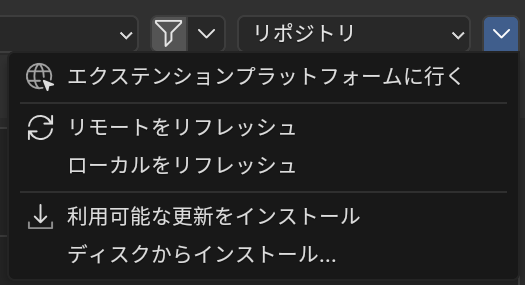

**2. Click Update**

When a newer version is available, **Update** appears on the Camera Frames row. Click it to install. Afterward, expand the details with the arrow on the left to check the installed version.

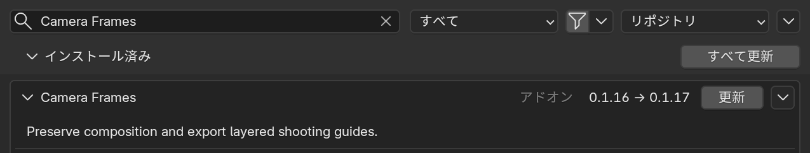

<a id="switch-from-zip"></a>

### Switch from a ZIP installation to updates in Blender

Uninstall the ZIP copy, then install Camera Frames from the update repository.

1. Save your `.blend` file. It contains your camera settings, FRAMEs, and paths.
2. In **Preferences… → Add-ons**, find Camera Frames and clear its checkbox.
3. In **Get Extensions**, find Camera Frames under **Installed** and choose **▼ → Uninstall** at the right of its row.
4. Follow [Install through Blender](#install-repository).
5. [Check that the add-on is enabled](#check-installation), then open your saved `.blend` file.

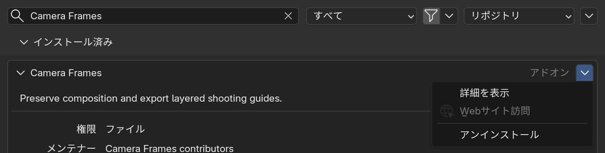

## License

GPL-3.0-or-later. [Full license](LICENSE).
