# Camera Frames for Blender

決めた構図を保ったまま、カメラに写る範囲を好きな方向へ広げられるBlenderアドオンです。足元を広く入れる、上に余白を足すなど、基点を選んで出力サイズを調整できます。

アニメ制作用に、カメラビュー上に撮影FRAMEを追加表示できます。作った撮影FRAMEは、ガイドとしてPSDに出力できます。

アイレベルを表示しながら構図を決めるほか、撮影FRAMEの換算焦点距離・画角を直接調整することもできます。

[導入方法](#installation) · [基本の使い方](#getting-started) · [Blender内で更新する](#update-extension)

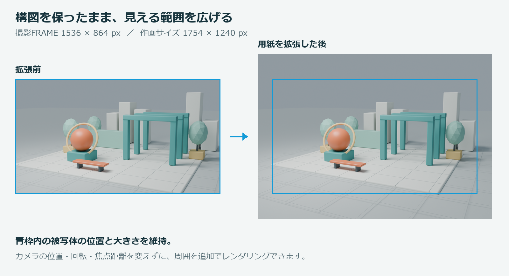

説明画像は、用紙 **1754×1240px（A4横・150dpi相当）**、撮影FRAME **1536×864px（16:9）** を基本にしています。

<a id="getting-started"></a>

## 基本の使い方

1. カメラオブジェクトを選び、**「選択カメラを登録」** を押します。
2. カメラビューで **「出力（用紙設定）」** を開き、固定基点を選んで用紙の幅・高さを調整します。
3. **「撮影FRAME」** でFRAMEを追加し、位置・大きさ・回転を調整します。
4. PANなどの撮影指示を作る場合はFRAMEを増やし、一覧の順番に沿って軌道をつなぎます。
5. **「ガイドPSDを書き出す」** で保存します。Blenderでレンダリングした画像と重ねて使うときは、同じカメラ・出力サイズでそろえます。

カメラごとの設定、FRAME、軌道は `.blend` に保存されます。

## 構図を保って、写る範囲を広げる

**「出力（用紙設定）」** で、構図のどこを固定して用紙を広げるかを選べます。たとえば下辺を固定して高さを増やせば、足元の構図を保ったまま上方向に写る範囲が広がります。固定基点は中央・辺・四隅の9か所です。

**「数値で変更」** で幅・高さを入力するか、**「ドラッグ」** でビュー上を動かして調整します。ドラッグでは右へ動かすと幅、上へ動かすと高さが増えます。縦横比の固定や、Shiftによる微調整も使えます。

用紙を広げても、被写体に対する撮影FRAMEの位置と大きさは保たれます。まずFRAME内の構図を決めてから、PANや作画に必要な余白を足していく使い方ができます。

画面に用紙を収めたいときは、**「ビュー操作」→「用紙を全体表示」** を押します。その後は「表示倍率 %」や − / ＋ で見やすい大きさに調整できます。「カメラをビューに」の切り替えも同じパネルにあります。

## 撮影FRAMEを配置・編集する

**「FRAMEを編集」** を押すと、ビュー内で枠を直接操作できます。枠内をドラッグすると移動、四隅をドラッグすると拡縮します。**「移動」「拡縮」「回転」「基点」** の各ボタンから操作を始めることもできます。終わったら「FRAME編集を終了」を押します。

- **数値で合わせる：** パネルのX・Y・幅・回転を入力します。初期の縦横比は16:9で、カメラごとに変更できます。
- **まとめて動かす：** 一覧のチェック、またはビュー内のShiftクリックで複数選択します。拡縮・回転には、一覧で編集中のFRAMEの基点を使います。
- **枠の外に基点を置く：** 基点もFRAMEも、用紙の外に置けます。

FRAMEを追加すると、赤・青・緑・黄・紫・水色の順に色が割り当てられます。色は個別にも変更できます。FRAME名は編集・操作中の対象に表示され、「撮影FRAME」見出しの **「名前」** で表示を切り替えられます。

一覧の目のアイコンはビューでの表示、**「PSD」** のチェックは書き出すFRAMEの選択に使います。

## 軌道を描く

FRAME一覧の順番が軌道の順番になります。**「軌道と補助線」** で「直線」または「ベジェ」を選び、曲線は黄色の接線ハンドルをドラッグして整えます。「自動」でつないだ曲線を「自由」に切り替えて手直しすることもできます。

接線ハンドルはFRAMEの中心につながっています。FRAMEが2つなら、最初のFRAMEに出る側、最後のFRAMEに入る側のハンドルが付きます。両方のFRAMEを選択すると、両端のハンドルを操作できます。

**「軌道位置」** では、中央・四隅・特定の角だけなど、ガイドに使う線を選べます。たとえば「左上」を選ぶと、その角を追った軌道をビューとPSDに描けます。FRAMEの回転や拡縮も反映されます。

## 撮影範囲の外をマスクする

**「FRAME外をマスク」** をオンにすると、撮影範囲の外側が暗くなり、構図を確認しやすくなります。不透明度は0〜100%で調整できます。

対象を **「アクティブFRAME」** にすると、編集中の1枚の範囲を確認できます。**「全FRAMEの通過範囲」** にすると、FRAMEが移動する途中も含めて使う範囲が残ります。S字の軌道や回転・拡縮を組み合わせた動きにも対応しています。

### 縦PANの例

用紙を上方向へ **1754×2480px** に広げ、下に始点のFRAME A、上に終点のFRAME Bを置いた例です。FRAMEはどちらも1536×864px。広場から建物の上部へPANするための、縦長の画像を用意できます。

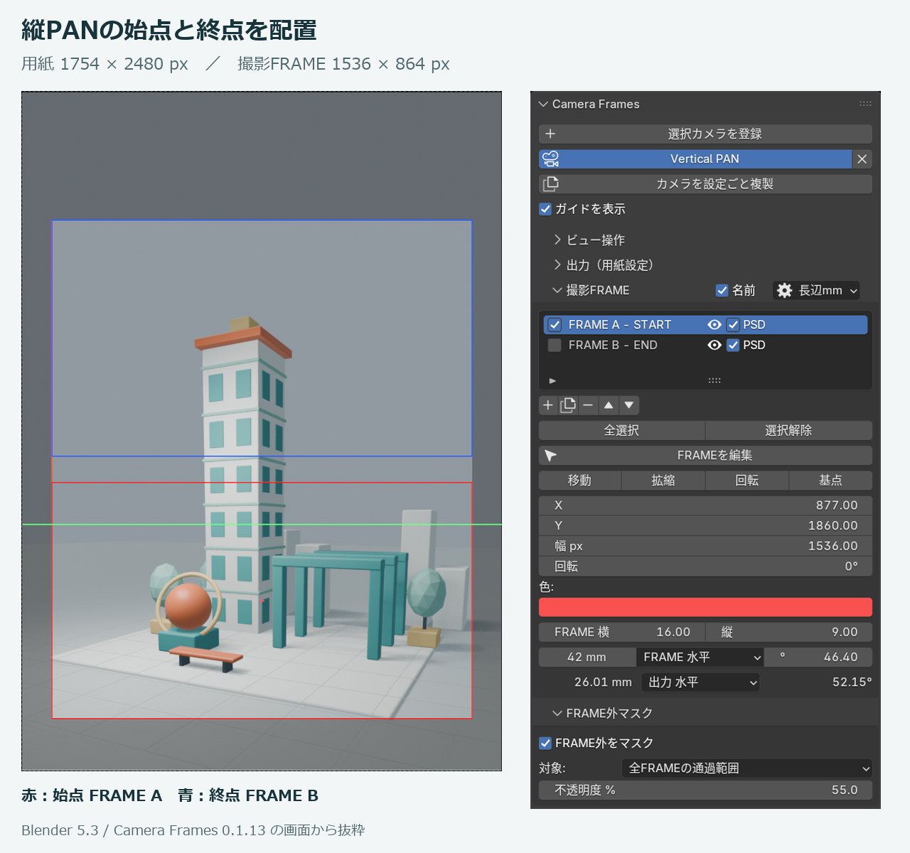

マスクは「全FRAMEの通過範囲」、不透明度55%です。軌道は左上の角を追って表示しています。移動中に必要な範囲を確認しながら、用紙の大きさを決められます。

## アイレベル・焦点距離・画角を確認する

**「軌道と補助線」** で、光軸とアイレベルを表示できます。カメラの傾き・ロール・レンズシフトに合わせて表示され、作画の目安としてPSDにも書き出せます。

撮影FRAMEの **「mm」または「°」をドラッグすると、カメラの見え方がその場で変わります。** 50mm相当のレンズで構図を探す、水平画角を指定して他のDCCと合わせる、といった調整に使えます。

| パネルの行 | できること |
| --- | --- |
| **FRAME** | 選択したFRAMEの換算焦点距離・画角を確認し、その数値からカメラを調整できます。 |
| **出力** | レンダリング範囲全体の換算焦点距離・画角を確認できます。 |

焦点距離はフルサイズ換算で表示します。画角はそれぞれ **水平・垂直・対角** から選べます。

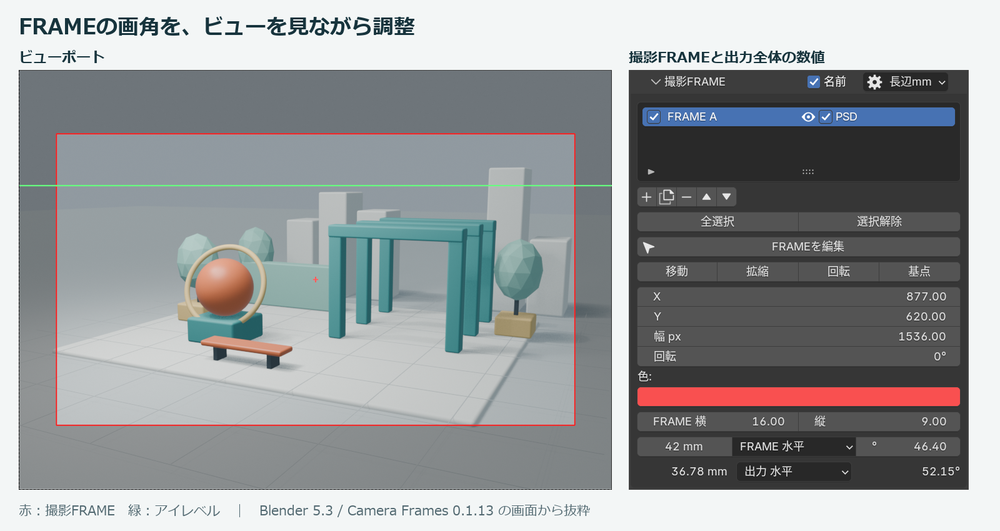

<details>
<summary>実写や他のDCCと画角を合わせるとき</summary>

表示している画角は、対象の範囲を光軸の中心に置いたときの基準値です。レンズシフトや中心から離れたFRAMEで構図を合わせるときは、**「長辺mm」の詳細にある光軸位置** も確認してください。左上が0%、右下が100%で、FRAMEと出力それぞれに対する位置が分かります。

比較する画像の撮像範囲・クロップ・ピクセル比率も確認すると、画角を合わせやすくなります。カメラの位置・向きやレンズの歪みは、それぞれの素材に合わせて調整してください。

</details>

## ガイドをレイヤー付きPSDに書き出す

**「ガイドPSDを書き出す」** で、背景が透明なPSDを保存できます。FRAMEごとにレイヤーが分かれ、軌道・光軸・アイレベルも個別のレイヤーになります。FRAME名がレイヤー名になるので、撮影指示に合わせた名前を付けておけます。

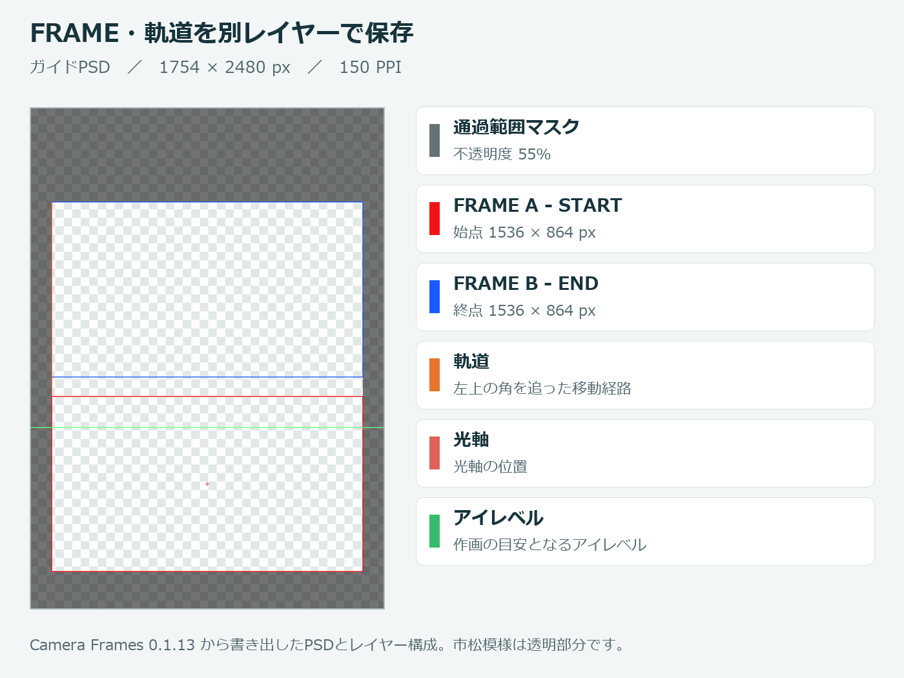

書き出すFRAMEは一覧の **「PSD」**、軌道・光軸・アイレベル・マスクは **「ガイドPSD」** の各チェックで選びます。光軸とアイレベルは、用紙内にあるものを書き出します。「マスクをPSDへ」をオンにすると、最下層にマスクが加わり、不透明度を画像編集ソフトでも調整できます。

PSDのキャンバスはBlenderの出力サイズにそろい、出力プロパティの倍率も反映されます。画像はBlenderで通常どおりレンダリングし、PSDのガイドと重ねて使えます。PSDに記録する印刷解像度は **「PSDのPPI」** で指定します。初期値は150PPIです。

## カメラを切り替える・複製する

複数のカメラに、それぞれの用紙設定・FRAME・軌道を保存できます。Camera Framesの一覧とアウトライナーは選択が連動し、カメラを切り替えるとその設定を呼び出します。名前もアウトライナーと共通です。

**「カメラを設定ごと複製」** を使うと、FRAMEやガイドを引き継いだ別のカメラを作れます。構図をいくつか試したいときに便利です。Blender標準の操作で複製したカメラも、「選択カメラを登録」で追加できます。

<details>
<summary>対応範囲・操作の補足</summary>

- **カメラ：** 透視投影・正投影のローカルカメラに対応します。焦点距離・画角の調整とアイレベルは透視投影用です。正投影ではFRAMEの投影幅を確認できます。
- **用紙とFRAME：** 用紙は各辺4〜30000px、FRAMEはカメラごとに128個までです。同じカメラ内のFRAMEは縦横比が共通です。
- **PSD：** 8bit RGB、各辺30000px以内、合計6400万画素までです。レンダー画像と重ねるときは、正方形ピクセルを使い、「領域にクロップ」をオフにしてください。
- **画面表示：** ガイドはBlenderのオーバーレイと連動します。ドラッグ編集は単一のカメラビューで行います。
- **軌道とマスク：** 軌道と「全FRAMEの通過範囲」は、表示・PSD出力のチェックにかかわらず一覧の全FRAMEから作ります。
- **出力サイズの変更：** Blender側で出力寸法を変えた場合は、「用紙サイズを出力に反映」で登録カメラの用紙設定に合わせられます。
- **アニメーションなど：** カメラの移動・回転アニメーションを使えます。カメラデータの共有やレンズなどへのアニメーション・ドライバーにより編集できない項目がある場合は、理由をパネルに表示します。
- **対応外のカメラ：** パノラマ・魚眼、リンク・ライブラリオーバーライド、複数シーンで共有するカメラには未対応です。カメラマーカーによる切り替えや、別カメラを指定したローカルビューへの自動追従も対象外です。

</details>

<a id="installation"></a>

## 導入方法

**Blender 5.2以降** に対応しています。以下はWindows・Blender 5.3の日本語UIで確認した手順です。インストール後の操作・PSD出力はオフラインでも使えます。

| 方法 | 更新するとき |
| --- | --- |
| [Blenderからインストールする（推奨）](#install-repository) | Blender内で「更新」を押す |
| [ZIPをダウンロードしてインストールする](#install-zip) | 新しいZIPをダウンロードして入れ替える |

すでにZIPから導入している方は、[Blender内で更新できるように切り替える手順](#switch-from-zip)をご覧ください。

まず、Blender上部の **「編集」→「プリファレンス…」** を開きます。

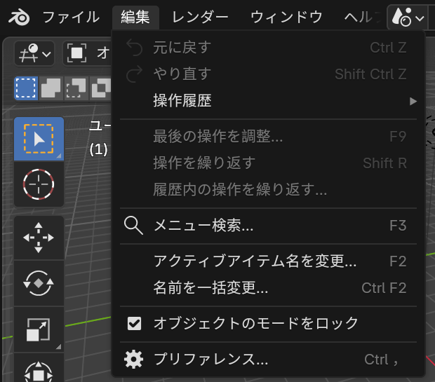

<a id="install-repository"></a>

### Blenderからインストールする（推奨）

**1.「エクステンションを入手」を開く**

プリファレンス左側の **「エクステンションを入手」** を選び、初回の案内で **「オンラインアクセスを許可」** を押します。

以前「オフライン継続」を選んだ場合は、**「システム」→「ネットワーク」→「オンラインアクセスを許可」** をオンにしてから戻ってください。

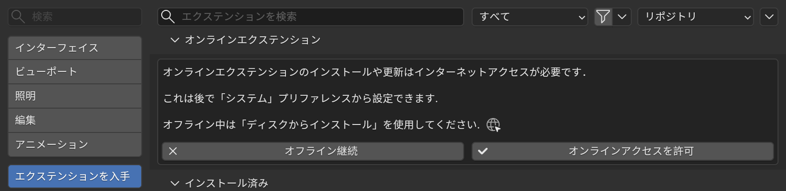

**2. 更新用リポジトリを追加する**

右上の **「リポジトリ」→「＋」→「リモートリポジトリを追加」** を選びます。

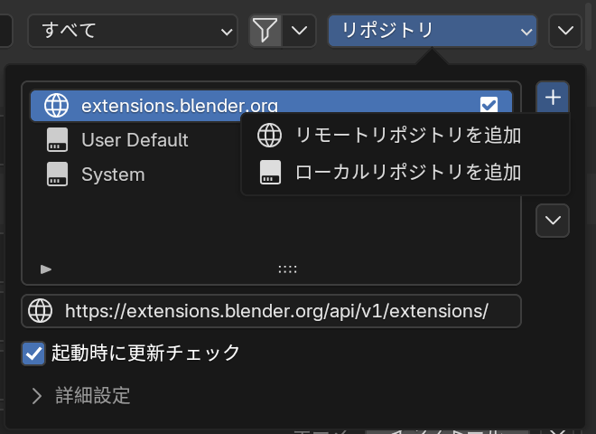

**3. URLを貼り付けて作成する**

「URL」に次のアドレスを貼り付け、**「起動時に更新チェック」** をオンにして **「作成」** を押します。

```text
https://stechdrive.github.io/blender-cameraframes/index.json
```

ほかの項目は初期設定のままで使えます。登録されるリポジトリ名は **stechdrive.github.io** です。

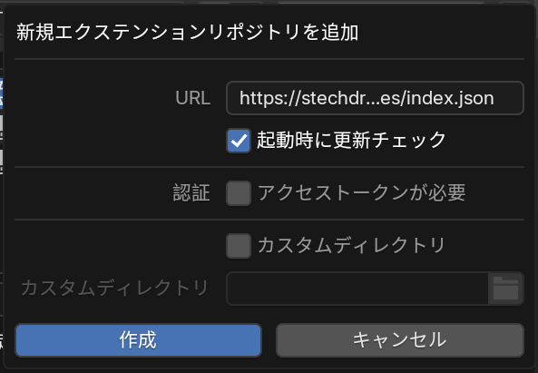

**4. Camera Framesをインストールする**

リポジトリのポップアップを閉じ、検索欄に **Camera Frames** と入力します。「利用可能」に出てきたCamera Framesの **「インストール」** を押します。

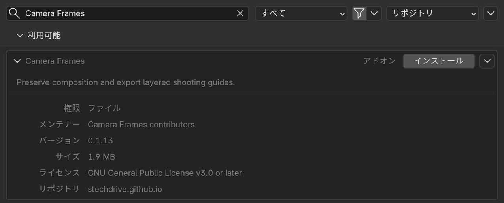

完了したら、[インストール後の確認](#check-installation)へ進みます。

<a id="install-zip"></a>

### ZIPをダウンロードしてインストールする

**1. 配布ZIPをダウンロードする**

[最新リリースのページ](https://github.com/stechdrive/blender-cameraframes/releases/latest)を開き、ページ下部の **Assets** から **`camera_frames-バージョン番号.zip`** を選んで保存します。

**2.「ディスクからインストール…」を選ぶ**

Blenderの **「編集」→「プリファレンス…」→「エクステンションを入手」** を開き、右上の **「▼」→「ディスクからインストール…」** を選びます。


**3. 保存したZIPを選ぶ**

ダウンロードしたZIPを **展開せずに** 選び、**「インストール後有効化」** をオンにして、右下の **「ディスクからインストール…」** を押します。

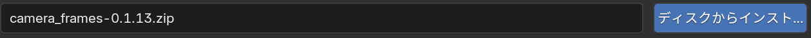

ZIP版を更新するときも、同じ手順で新しいZIPを指定します。

<a id="check-installation"></a>

### インストール後の確認

プリファレンス左側の **「アドオン」** で **Camera Frames** を検索し、名前の左側のチェックをオンにします。

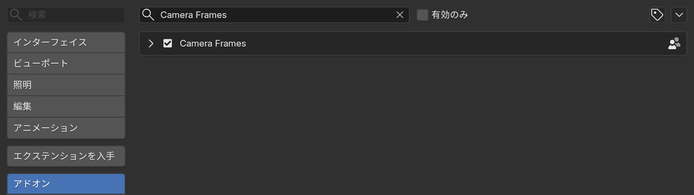

プリファレンスを閉じ、**3Dビューポートにマウスを置いてNキー** を押すと、サイドバーの **Camera Frames** タブを開けます。プリファレンスの自動保存をオフにしている場合は、閉じる前に「プリファレンスを保存」を押してください。

<a id="update-extension"></a>

### Blender内で更新する

更新用リポジトリを登録すると、Blenderの起動時に新しい版を確認できます。インストールは **「更新」** ボタンで行います。

**1. 更新情報を確認する**

作業中の `.blend` を保存し、**「プリファレンス…」→「エクステンションを入手」** でCamera Framesを検索します。最新の情報を取得するには、右上の **「▼」→「リモートをリフレッシュ」** を選びます。

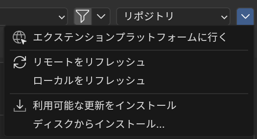

**2.「更新」を押す**

新しい版があると、Camera Framesの行に **「更新」** が表示されます。押すとインストールが始まり、完了後は左の矢印で開く詳細からバージョンを確認できます。

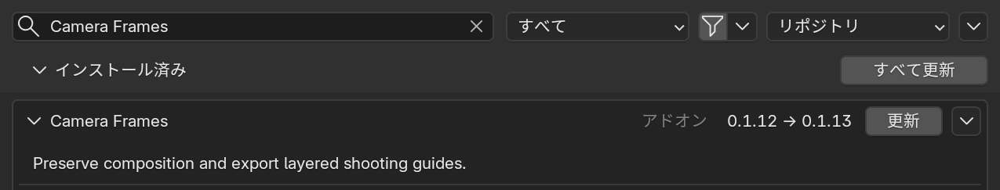

<a id="switch-from-zip"></a>

### ZIP版から、Blender内で更新できるように切り替える

ZIP版を一度アンインストールし、更新用リポジトリから入れ直します。

1. 作業中の `.blend` を保存します。カメラの設定・FRAME・軌道はこのファイルに保存されます。
2. **「プリファレンス…」→「アドオン」** でCamera Framesを検索し、チェックを外して無効にします。
3. **「エクステンションを入手」** の「インストール済み」にあるCamera Framesの右端 **「▼」→「アンインストール」** を選びます。
4. [Blenderからインストールする手順](#install-repository)に沿って導入します。
5. [有効化を確認](#check-installation)し、保存した `.blend` を開きます。

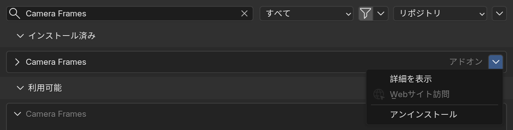

## ライセンス

GPL-3.0-or-later。[ライセンス全文](LICENSE)
