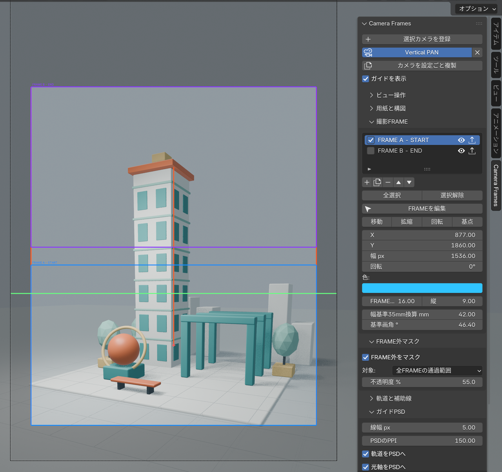
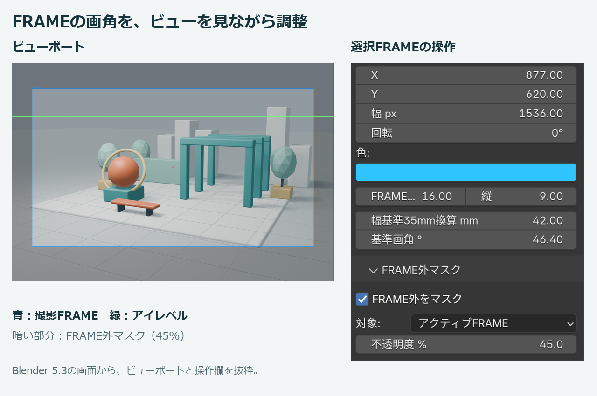
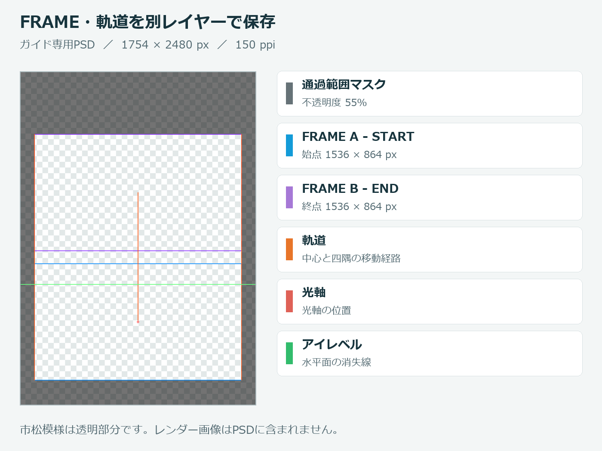

# Camera Frames for Blender

決めた構図を保ったまま、基点と広げる方向を選び、カメラに見える範囲を拡大できるBlenderアドオンです。バージョン0.1.9。

アニメ制作向けには、レンダリングサイズを **作画サイズ（紙作業でいう用紙サイズ）** として扱い、その中に **撮影FRAME** を配置できます。FRAMEの位置・大きさ・回転や移動軌道を調整し、後工程の撮影でフレームアタリとして使うガイドを、レイヤー付きPSDに書き出せます。

アイレベルを表示でき、選択した撮影FRAMEの **35mmフルサイズ換算の焦点距離・基準画角** を確認しながら直接調整できます。換算値はFRAMEの横幅を基準にしています。

この説明とアドオンの画面では、作画範囲全体を「用紙」、撮影時に使う範囲を示す枠を「撮影FRAME」と呼びます。用紙を広げても、元の構図に対するFRAMEの位置と大きさを保てます。

画像のレンダリングにはBlenderの通常の機能を使います。撮影ガイドはPSDとして別に出力します。

説明画像の基本設定は、用紙 **1754×1240px（A4横・150dpi相当）**、撮影FRAME **1536×864px（16:9）** です。Blender 5.3で作成した自作のテストシーンを使用しています。

## 対応環境と導入

- Blender 5.2以降。Windowsの5.2 / 5.3で検証しています。
- 透視投影・正投影のローカルカメラに対応します。
- インストール後の操作やPSD出力は、オフラインで利用できます。

配布ZIPをBlenderの「プリファレンス → エクステンション」メニューにある「ディスクからインストール」で選び、有効にしてください。3Dビューのサイドバー（Nキー）に **Camera Frames** が追加されます。

## 基本の使い方

1. 構図を作ったカメラオブジェクトを選び、「選択カメラを登録」を押します。現在の出力寸法・倍率・ピクセル比率を取り込みます。
2. カメラビューで、固定基点と用紙の幅・高さを調整します。「数値で変更」は数値欄のドラッグでも連続変更できます。「ドラッグ」はビュー内で右へ動かすと幅、上へ動かすと高さが増えます。
3. FRAMEを追加・複製し、位置・幅・回転を編集します。用紙のサイズを変えても、被写体に対するFRAMEの位置と大きさは維持されます。
4. 必要に応じて軌道を編集します。FRAME一覧の順番が経路の順番になります。
5. 「ガイドPSDを書き出す」で保存します。Blenderでレンダーした画像と重ねるときは、同じカメラと出力寸法を使用してください。

設定・FRAME・軌道は `.blend` に保存されます。

## 出力（用紙設定）

用紙サイズを変更すると、レンダリングする範囲も変わります。固定基点を選ぶことで、中央から上下左右に広げたり、片側を固定して反対側へ広げたりできます。元の構図内の被写体の位置と大きさを保ち、カメラの位置・回転・焦点距離は維持します。

- 3×3の固定基点。基点を選び直すだけでは構図は変わりません。
- 縦横比固定、Shiftで微調整、Escで操作開始前へ取消。ドラッグ1回を1回のUndoで戻せます。
- 単一カメラビューでは、元のFRAMEの画面上の位置と倍率も維持します。Blenderのカメラビュー倍率の上限・下限を超える変更では、表示倍率はその限界に制限されます。
- 「ビュー操作」の「用紙を全体表示」はビューポートの表示だけを変更します。その後も「表示倍率 %」のドラッグ・数値入力や − / ＋ で拡大・縮小できます。100%は用紙幅と画面上の幅が同じピクセル数になる倍率です。
- 「カメラをビューに」はBlenderのビュータブと同じ設定です。このパネル内で切り替えられます。オンのままでも、このアドオンの表示倍率操作はカメラの構図・用紙寸法・出力倍率を変更しません。通常のビュー移動はBlenderの設定に従ってカメラを動かします。

用紙は各辺4～30000px。奇数pxの余白は整数に丸めて左右・上下へ配分するため、中央基点では片側に1px多く付く場合があります。

出力倍率はBlenderの「出力プロパティ」で調整します。ガイドPSDにもその倍率が反映されます。カメラ切り替えや用紙変更では倍率を変更しません。

## 縦PANの例

幅1754pxのまま、用紙を上方向へ **1754×2480px** に広げた例です。下の **FRAME Aが始点**、上の **FRAME Bが終点**。どちらも1536×864pxです。縦長の画像をレンダリングし、後工程の撮影で、広場から建物の上部へ縦PANするためのフレームアタリとして使えます。

マスクの対象を「全FRAMEの通過範囲」にすると、移動中に必要な範囲を残し、その外側を暗く表示できます。上の例では不透明度を55%にしています。

## 複数カメラ

登録一覧には、アウトライナーのカメラオブジェクト名をそのまま表示します。オブジェクト名を変更すると一覧にも反映され、再登録は不要です。

登録一覧とアウトライナーのカメラ選択は連動します。どちらから選んでも、そのカメラを選択し、シーンの使用カメラと出力寸法・ピクセル比率を切り替えます。メッシュなど、カメラ以外のオブジェクト選択では切り替えません。

未登録のカメラを選ぶと「未登録のカメラです」と表示し、登録カメラの編集欄を閉じます。使う場合は「選択カメラを登録」を押してください。選択だけで自動登録したり、別のカメラの用紙設定を適用したりはしません。

Blender側で出力の幅・高さやピクセル比率を直接変更した場合は、用紙設定との違いを表示します。「用紙サイズを出力に反映」で、そのカメラの用紙寸法・ピクセル比率へ戻せます。出力倍率だけの変更では、この操作は不要です。

「カメラを設定ごと複製」で作ったカメラは、カメラ設定・ガイド・カメラ自身のアニメーションを元とは独立して編集できます。親オブジェクトや、コンストレイント・ドライバーの参照先は元と共有します。

Blender標準の複製操作で作ったカメラは「選択カメラを登録」で追加します。共有されていたカメラ設定も、登録時に個別に編集できる状態になります。「登録解除」は一覧から外す操作で、カメラや保存設定は削除しません。

## FRAMEと軌道の編集

FRAMEはカメラごとに最大128個。比率はカメラ内で共通、初期値は16:9です。比率変更ではFRAMEの幅と中心を維持します。用紙の縦横比とは独立しています。

新しいFRAMEの色は赤から始まり、追加・複製すると青→緑→黄→紫→水色→赤の順に循環します。色は個別に変更できます。既存ファイルの色は更新後も保持します。

- FRAME一覧のチェックが複数選択です。何もチェックされていない場合は一覧のアクティブ行を操作します。
- パネルの「FRAMEを編集」で編集を開始し、「FRAME編集を終了」で通常の選択ツールへ戻ります。左ツールバーの **Camera Frames** ツールでも開始できます。枠内をドラッグして移動、四隅で拡縮、黄色のハンドルでベジェを編集します。
- 四隅の白い□・基点・ベジェ操作点は、FRAME編集ツールまたはFRAMEのドラッグ操作が有効な間だけ表示します。編集終了後もFRAME・軌道・光軸・アイレベルは表示されます。
- 名前はFRAME編集・操作中に、選択または操作対象のFRAMEだけに表示します。「撮影FRAME」見出しの「名前」チェックを外すと、操作中も非表示になります。一覧の名前とPSDのレイヤー名はそのままです。
- Shiftクリックで選択を追加・解除できます。操作開始後のShiftは微調整です。
- 「移動」「拡縮」「回転」「基点」を押してからビュー内でドラッグする方法もあります。拡縮と回転はアクティブFRAMEの基点を使用し、複数選択では同じ基点で一括変形します。
- 基点はFRAMEや用紙の外にも置けます。FRAME自体も用紙の外へ移動でき、PSDには出力範囲内の線だけを書き出します。
- パネル内のX・Y・幅・回転の直接入力はアクティブFRAMEの中心を基準とします。
- 軌道は直線またはベジェ。自動・角・対称・自由のハンドルに対応し、四隅の軌道も表示できます。FRAMEから実カメラのキーフレームを作る機能ではありません。

FRAME一覧の目のアイコンは画面表示、右端の「PSD」チェックはPSDへの書き出しです。画面表示とPSDへの出力は別々に選べます。軌道は一覧にある全FRAMEを結びます。FRAMEを非表示またはPSD出力の対象外にしても、軌道はそのFRAMEを通ります。

## FRAME外マスク

「FRAME外をマスク」で用紙内の撮影範囲外を暗くできます。不透明度は0～100%。対象は一覧の「アクティブFRAME」1枚、または「全FRAMEの通過範囲」です。全FRAMEでは一覧順に、中心の直線／ベジェ移動・幅の変化・短い側の回転を補間した範囲を抜きます。枠線の表示・PSD出力チェックはマスク対象を除外しません。

軌道線とマスクは同じ補間を使用します。S字、折り返し、回転・拡縮、重なる経路に対応し、重なりで不透明度は変わりません。マスクはガイド線・編集ハンドルの下に表示します。

画面上のマスクは、大きく拡大すると境界がぼやける場合があります。PSDのマスクは出力画像の大きさに合わせて書き出します。極端に細長いFRAMEや大きく曲がる軌道で警告が出る場合は、FRAMEの比率・大きさやベジェハンドルの位置を調整してください。

## FRAMEの換算焦点距離と基準画角

青い枠が撮影FRAME、緑の線がアイレベルです。右のパネルでFRAMEの換算焦点距離・画角を直接調整できます。

透視投影では、撮影FRAMEの横幅を35mmフルサイズの横幅に対応させた換算焦点距離と、基準画角を表示します。アクティブFRAMEの「幅基準35mm換算 mm」と「基準画角 °」を直接編集でき、どちらをドラッグしても操作中にBlenderカメラの焦点距離とビューが変化し、もう一方の数値も連動します。数値の直接入力は確定時に反映され、適用ボタンは不要です。例えば換算50mmなら、基準画角は約39.60°です。

FRAMEの位置・幅・回転、用紙寸法は維持します。同じカメラ全体の画角が変わるため、他のFRAMEの換算値や見え方も変わります。FRAMEの編集・切り替えや、Blender標準の焦点距離変更でも表示値が更新されます。数値欄は現在の状態を表し、固定する目標値ではありません。

ドラッグ中のEscで取消、ドラッグ1回単位のUndo/Redoに対応します。Blenderの焦点距離の限界では設定可能な値に収まります。カメラ設定を複数のカメラで共有している場合や、レンズなどの設定にアニメーション・ドライバーがある場合は、この数値欄を編集できません。理由はパネルに表示されます。カメラの移動・回転アニメーションは使用できます。

## ガイドPSD

縦PAN例から実際に書き出したガイドと、そのレイヤー構成です。FRAMEごと、軌道、光軸、アイレベル、マスクを分けて扱えます。

- 8bit RGB、背景透明。FRAMEごとのレイヤーと独立した「軌道」「光軸」「アイレベル」レイヤーを作ります。
- 一覧の後ろのFRAMEほど上のレイヤーになり、その上に軌道、光軸、アイレベルを重ねます。日本語のFRAME名を保持します。
- 「マスクをPSDへ」で、最下層に独立した「通過範囲マスク」レイヤーを追加できます（初期状態はオフ）。画面表示とは独立して、マスクの対象と不透明度を反映します。不透明度はPSDのレイヤー不透明度として保存し、画像編集アプリ側でも変更できます。マスクだけの出力にも対応します。
- 「光軸をPSDへ」「アイレベルをPSDへ」は初期状態でオンです。画面表示をオフにしても出力されます。PSDから除外するときは出力スイッチをオフにしてください。
- 光軸とアイレベルは、表示と同じカメラ投影・用紙座標・色を使用します。共通の線幅と出力倍率を反映します。光軸の十字は100%時に16pxの大きさです。
- 紙面外の光軸・アイレベル、および正投影のアイレベルは、チェックを保持したまま出力を省略します。出力できるガイドが一つもない場合はファイルを作成・置換しません。
- 用紙全体のキャンバスと原点を保持します。枠線の紙外部分は切れますが、透明な外周を自動トリミングしません。
- 出力倍率を反映した画素寸法で保存します。例えば用紙1920×1080、50%ならPSDは960×540pxです。
- PSDのPPIは初期値150。PPI変更では画素数や構図は変わりません。このPPI設定は、Blenderで保存する画像には反映されません。
- PSDは各辺30000px以内、合計6400万画素まで。正方形ピクセル・全キャンバスの出力に対応します。「領域にクロップ」を使うレンダーには対応しません。
- PSDにはガイドを書き出します。レンダー画像や、画面上のFRAME名・編集用ハンドルは含めません。

## 補助表示と対応範囲

光軸は用紙中心とは独立した位置に表示します。アイレベルは世界の水平面の消失線を表示し、カメラのロール・傾き・シフト、および親の非一様スケールを反映します。線が紙面外にある場合や、正投影、カメラや親のスケールが0などで投影できない場合は表示しません。

透視投影のレンズ情報は、アクティブFRAMEの横幅を基準にした35mm換算と基準画角です。FRAMEの位置を変えたり、レンズシフトを変更したりしても、この換算値は変わりません。正投影では投影幅を表示します。

パノラマ・魚眼、リンク・ライブラリオーバーライドのカメラ、複数シーンで共有するカメラには未対応です。レンズなどのカメラ設定にアニメーション・ドライバーがある場合は、用紙サイズを変更できません。カメラの移動・回転アニメーションは使用できます。

カメラマーカーによるアニメーション中の切り替え、別カメラを指定したローカルビューには自動追従しません。ガイドのドラッグは単一カメラビューで使用してください。

画像サイズやレイヤー数が多いPSDは、保存に時間がかかる場合があります。

## ライセンス

GPL-3.0-or-later。[ライセンス全文](LICENSE)を参照してください。
